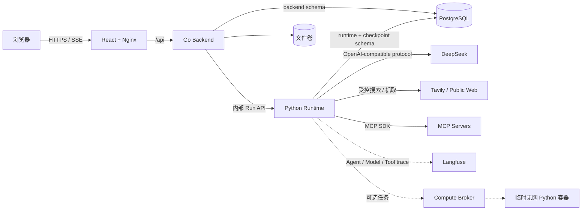

# 架构说明

序光是一个面向个人工作的单主 Agent 系统。第一阶段采用小型 Harness 核心，通过模型、工具、技能、文件工作区与可选隔离计算扩展能力；它不是公司级多租户控制面，也没有复制公司灵机 AI 的 Business Gateway、独立 Tool Gateway 或 Model Gateway 部署拓扑。

## 组件职责

| 组件 | 技术 | 权威职责 | 不负责 |
| --- | --- | --- | --- |
| Web | React、TypeScript、Ant Design、Nginx | 对话、资料、审批、产物和管理界面 | 业务事实、工具执行、模型密钥 |
| Backend | Go、Gin、GORM | 用户/RBAC、会话、模型与技能配置、MCP 元数据、审批、文件和审计 | Agent loop、模型 HTTP、任意本地代码执行 |
| Runtime | Python、FastAPI、DeepAgents、LangGraph | Run 生命周期、模型调用、上下文、工具准入、canonical events、checkpoint | 用户和配置的长期权威数据、原始文件存储 |
| PostgreSQL | PostgreSQL 17 | Backend/Runtime 各自 schema 和独立角色 | 文件二进制、模型密钥 |
| demo-mcp | Python MCP SDK | 本地合成只读 MCP 验收服务 | 真实业务系统 |
| Compute Broker | 可选 Docker profile | 创建受限、非 root、禁网、短生命周期计算容器 | 默认常驻运行、访问部署凭据 |

Tool Gateway 在第一阶段是 Runtime 内的逻辑边界，不是独立微服务。它统一执行参数校验、作用域、审批绑定、幂等、取消、审计和目标路由。模型目前由 Runtime 按 `openai_chat_completions` 协议直接访问；未来只有在多渠道路由成为实际需求时才引入独立 Model Gateway。

## 一条 Run 的调用链

1. Web 向 Backend 创建 thread/run，并显式提交模型、技能、文件和联网授权。
2. Backend 依据权威配置生成请求级能力快照，将 Run 交给 Runtime。
3. Runtime 在 PostgreSQL 队列中领取 Run，以 DeepAgents 组装模型、工具、技能和文件工作区。
4. 模型产生工具请求；逻辑 Tool Gateway 校验快照、参数、预算、目标与审批状态。
5. 文档在首次读取时由受限子进程解析并缓存；MCP、Tavily、公网页面与可选 Python 分别走受控执行器。
6. Runtime 先写 canonical events，再由 Backend/Web 投影流式步骤和最终结果；Langfuse 只接收脱敏后的 Agent、模型和工具观测副本。
7. 长结果外置为来源或文件；报告只能引用本 Run 已实际读取的 source_id。

## 数据与秘密边界

- `backend`、`runtime`、`runtime_harness_v2` 使用独立 schema/数据库角色。
- 文件卷只挂载给 Backend；Runtime 通过受控内部 API 读取授权文件。
- DeepSeek、Tavily 和 Langfuse Key 只注入 Runtime 容器环境，不进入数据库、事件、checkpoint、报告或 Git。
- `schemas/` 是跨 Go/Python/TypeScript 契约权威源；生成副本不手改。
- `.env`、`.env.test`、备份、构建产物和本地依赖均被 Git 忽略。

## 当前边界

- 已真实验证 DeepSeek、远程只读 HTTP MCP、Tavily、公网页面、DOCX/PDF/XLSX、报告和 Langfuse。
- 通用 MCP 写工具、stdio MCP、OAuth、OCR、PPT/WPS、长期记忆、自动化和子智能体属于后续阶段。
- 当前面向单实例个人 Demo；不承诺生产高可用、企业多租户或任意断点恢复。
