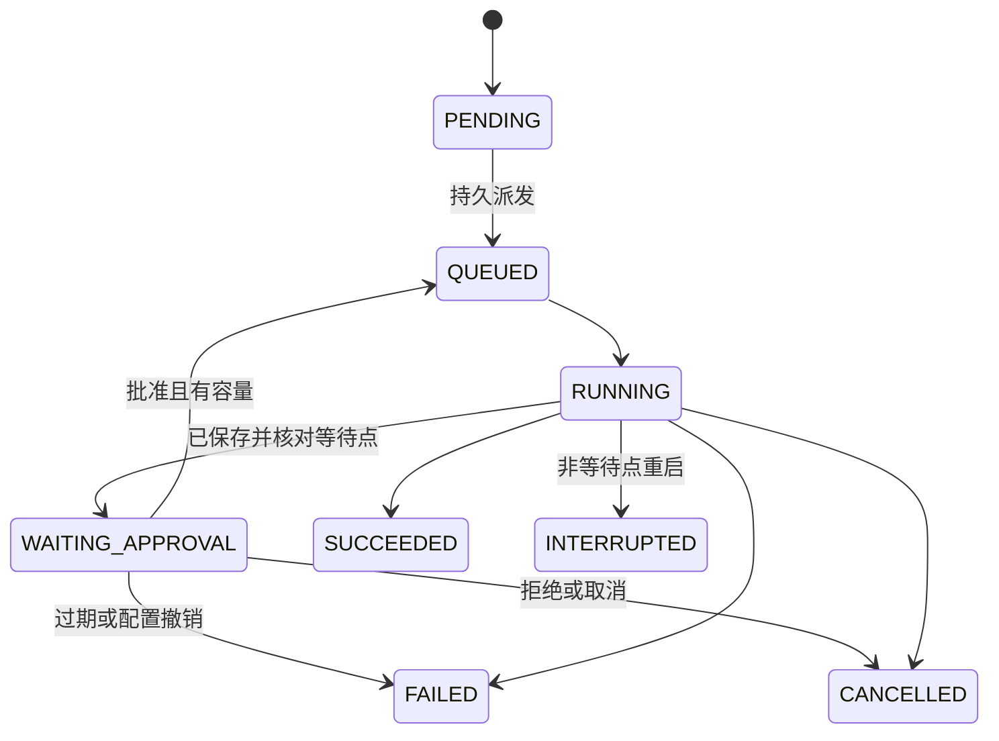
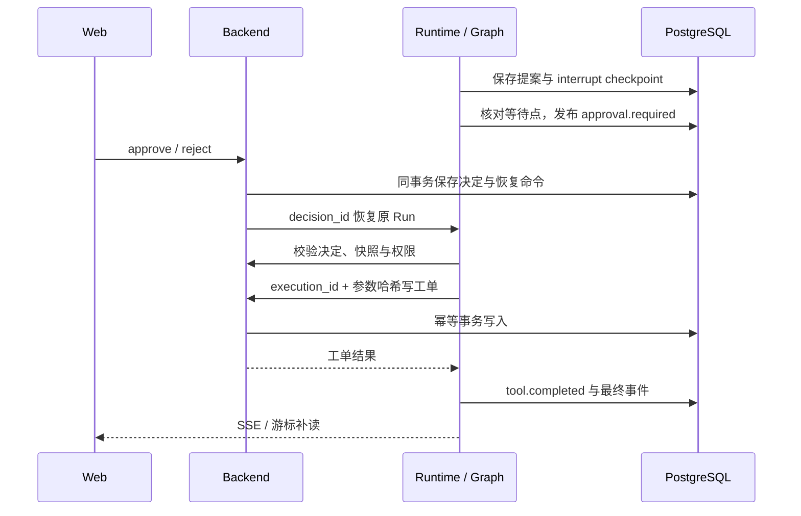

# Day 4–7 交付与演示

本项目是独立个人工程：Web 是入口，Backend 持有用户、配置、提交意图、审批决定、工单和文件索引；Runtime 持有执行、事件与 LangGraph checkpoint。没有修改或复制公司项目。

## 三个关键决策

1. 审批采用持久 interrupt。准备提案、暂停节点和执行写入分开；只有证明 checkpoint 在正确等待节点，才发布 WAITING_APPROVAL。
2. 写入有 execution_id 与参数哈希。重复批准返回同一个决定；响应丢失查询原结果，查询不可达显示 UNKNOWN。每个 Run 最多一张演示工单，取消不会回滚已写入数据。
3. 文件保存到 Backend 的独立卷，浏览器只使用 file_id。CSV 由固定 Decimal 程序求和、计数或平均，模型仅解读结果；Markdown 报告直接读取持久结果，不消耗模型请求。

## 一条请求的完整路线

Web 提交 → Backend 验证用户和资料归属，冻结模型/技能/MCP/内置工具快照 → 持久提交与派发命令 → Runtime 入队 → LangGraph 模型节点 → Tool Gateway 验证快照与参数 → 只读 MCP 或受控文件工具。

写工具会先形成完整参数提案 → 保存 interrupt checkpoint → 页面展示审批卡 → Backend 记录不可变决定和恢复命令 → Runtime 重新校验归属、版本、过期时间和取消标记 → Backend 在同一事务锁下再次校验并幂等写工单 → 持久事件 → 最终消息与产物。

配置生效链路：管理员保存 → Backend revision 增加 → 前台目录读取新配置 → 新 Run 冻结新版本。已暂停 Run 不静默换模型；旧快照被撤销时明确失败。

## 五段演示

1. 管理控制台配置 DeepSeek、平台技能与演示 MCP；切换工作台，选择模型/技能发送两轮消息，查看历史延续与流式正文。
2. 资料库上传 UTF-8 TXT/MD，选择“用于对话”，新建会话后要求读取附件。未选入本轮的 file_id 无法读取。
3. 上传 CSV，进入“数据分析”，选择维度、指标、sum/count/avg 与柱/折线图。图表显示来源、行数、统计口径和单位，下载真实汇总 CSV。
4. 请求创建 DEMO-1001 工单；如果模型先用文字征询，明确要求“调用工具提交提案，由系统审批卡等待决定”。查看完整参数、拒绝或批准。等待时重启 Runtime 后回到同一审批；开发环境不要启用故障开关。
5. 成功后导出 Markdown，重复导出仍是同一文件。到管理“运行记录”查看 run_id、用户、模型、创建时间、状态与错误，再到审计关联审批及写入。

## 边界

- 单实例 Runtime，4 个执行槽、32 个排队任务；等待审批不占执行槽。SSE 每用户 4 条、进程总 32 条。验证是配置边界测试，不代表生产容量。
- 审批默认 10 分钟有效。仅有受控演示写工具，不执行任意代码；演示订单/工单均是合成数据。
- 恢复只支持可证明的审批等待点。其他运行中的崩溃明确 INTERRUPTED；对于已提交但未确定的写入只核查，不重放模型或盲重试写入。
- 本机 PostgreSQL 和文件卷持久化；不是高可用、灾备或对象存储产品。文件孤儿在下次 Backend 启动时清理超过一小时的本服务无索引对象。
- TXT/MD 最多 50,000 字符；CSV 最多 10,000 数据行、30 列、50 分组；每轮最多 3 个文件、每个 5 MB。大 CSV 可统计，全文预览仍受 50,000 字符限制。
- DeepSeek 使用 openai_chat_completions 与 thinking.disabled。其他平台协议扩展位置已保留，未经真实验收不宣称兼容。
- 前端构建仍有大 bundle 提示；当前为本机演示可用范围，尚未做生产 CDN/路由分包优化。
- 真实调用记录含 provider 返回 tokens；没有读取账单 API，因此不把 tokens 换算成已核实费用。

## 故障复验

`tests/compose/fault-injection.yaml` 仅用于隔离验收项目：ENABLE_FAULTS 加上指定 FAULT_* 才生效。覆盖等待点保存后未发布、决定保存后未派发、写入后响应丢失、查询不可达、写入后进程恢复、产物索引失败。FaultPause 是可复现的边界暂停，再重启进程；不将其称为硬件断电模拟。

发现的问题与修复记录见 acceptance-report.md。完整结果以实际证据为准。

## 可用于简历的事实表述

“在 AI 协作下设计并实现个人 Agent 工作区，分离 React / Go 控制面 / Python LangGraph Runtime；实现持久审批、幂等受控写入、事件补读与固定 CSV 分析，并通过隔离服务与故障窗口验收。” 不写企业规模、公司项目成果或未验证的生产指标。
