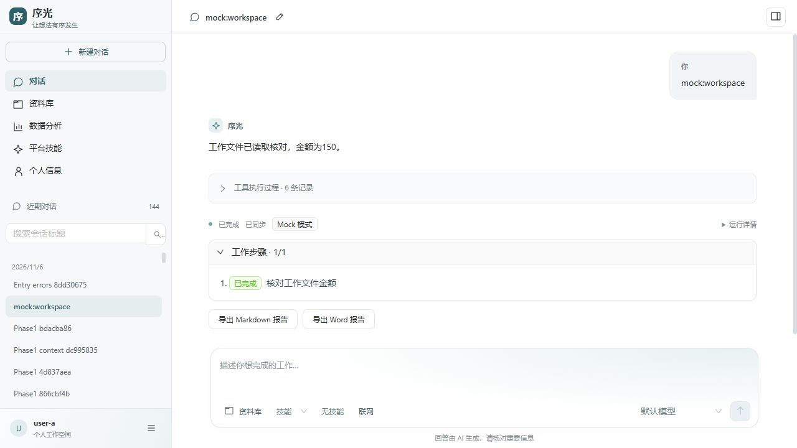

# 第一阶段重构验收记录（2026-11-06）

**结论：第一阶段 S08–S20 的开发、隔离回归、真实 DeepSeek/Tavily 工具链和日常 5173 切换均已完成。** 这证明当前个人 Demo 可日常使用，不代表生产高可用或所有站点/供应商质量均已认证。用户确认现有数据为演示数据，撤销备份/回滚交付项，相关脚本和产物未保留。

初次完整回归依据用户“开始进行验收”的明确授权执行。项目为独立 agent-workspace；公司灵机 AI 未修改。验收项目 `agent-workspace-verification` 使用独立数据库/卷和 5174，日常 5173 未切换。初次回归模型输出采用 Mock，其余 DeepAgents、PostgreSQL、MCP、审批、文件、按需解析、工具治理与 Docker 进程均运行真实模块；网页上游是显式本地 fixture，当次真实模型请求 **0**、真实付费搜索请求 **0**。随后获得新的 **12 次请求 × 每次 4096 输出 token** 授权：使用 4 次 DeepSeek 请求完成 DOCX/MCP 两条工具任务，2 次完成真实公网正文读取，4 次完成真实 Tavily 搜索、IANA 正文读取和引用报告，共使用 10/12 次模型请求；Tavily 使用 1/3 次搜索预算。证据见 [真实 DeepSeek 结果](evidence/personal-agent-deepseek-real-results.json)、[公网正文结果](evidence/personal-agent-public-web-real-results.json)与[Tavily 研究结果](evidence/personal-agent-tavily-real-results.json)。

## 实际执行与证据

下表数字是各脚本记录的检查组数或单元用例数，存在交叉覆盖，不相加包装成互不重复的测试数量。

| 范围 | 结果 | 证据 |
| --- | --- | --- |
| 原有业务回归 | 7 个脚本、48 个检查组通过 | [Day2/13](evidence/day2-api-results.json)、[Day3/9](evidence/day3-mock-results.json)、[交付/6](evidence/day4-5-results.json)、[故障/10](evidence/day6-fault-results.json)、[边界/6](evidence/day6-boundary-results.json)、[存储/2](evidence/day6-storage-results.json)、[SSE/2](evidence/day6-stream-results.json) |
| 新增文档/研究/产物 | 7 组通过 | [集成](evidence/phase1-integration-results.json) |
| 原生文件/摘要/预算/解析 | 6 组通过 | [深度验收](evidence/phase1-depth-results.json) |
| 提交错误与资源准入 | 6 组通过 | [入口错误](evidence/phase1-entry-error-results.json) |
| 实际 Docker 隔离 | 8 组通过 | [隔离](evidence/phase1-compute-results.json) |
| Harness 到实际 Python 容器 | 2 组通过 | [计算全链路](evidence/phase1-compute-flow-results.json) |
| 迁移保护与重复迁移 | 3 组通过，保留 1,312 条新 checkpoint | [迁移](evidence/phase1-migration-results.json) |
| 离线单元检查 | 23 个用例最终均通过；初次 22/23，修复测试配置后定向复跑 1/1 | [单元结果及复跑说明](evidence/phase1-unit-results.json) |
| 实际浏览器业务操作 | 17 项通过，含桌面和 390×844 窄屏 | [浏览器记录](evidence/phase1-browser-results.json) |
| Linux 镜像、Go、Web、契约 | 构建和静态核对通过 | [构建](evidence/phase1-build-checks.json)、[源码契约](evidence/phase1-source-checks.json) |

原有回归实际验证了：模型协议配置、RBAC/归属、技能/MCP 撤权、流式断线与游标重放、多轮历史、幂等入队、审批批准/拒绝/过期/重启恢复、批准与取消竞态、写入已提交但响应丢失的对账、UNKNOWN 不盲重试、存储不可写/物理对象丢失、32 队列和 32 SSE 订阅边界。并非只检查页面能打开。

新增链路得到的可核查结果：

- 文字 PDF 由真实 worker 提取并定位到物理第 1 页；DOCX 保留段落/表格顺序并能在界面定位。两份文档产生带来源的 MD/DOCX，v2 保留 v1，外用户读取被拒绝。
- 原生 `write_todos`、write/edit/read 工具经过受控 Backend，工作文件 revision=2、有执行审计。长工具结果实际外置；实际触发官方摘要、保存原始历史，摘要占用同一模型预算；重复调用达到 12 次后以 `MODEL_CALL_LIMIT` 明确终止。
- XLSX 通过真实读取与 Decimal 汇总，得到东=30、西=7；Chart/CSV 与该结果一致。Python 容器读取本轮授权 CSV 的 4 和 9，实际运算并发布结果 **13**，不是常量输出。
- 网页 fixture 实际执行搜索，产生 **3 个 search_only 摘要 + 3 个已读正文来源**，无 tool.failed；报告只引用已读来源。Loopback URL 仍被拒绝。该结果不能证明 Tavily 凭据或真实公网可用。
- Docker 任务实际非 root、根目录只读、禁网、无部署凭据/无 Docker socket；验证真实运行取消/超时、前置取消、幂等重放、参数冲突、输出数量和符号链接拒绝。收尾 **0 个任务容器、0 个任务卷**。
- 浏览器实际登录/提交/审批/取消/刷新、查看来源、切换 v2→v1→v2、完成中文 DOCX 下载（37,157 字节，ZIP PK 签名）。UI 审批只产生 **1 张**合成工单。完成态无空白助手消息，待接入阶段不再误报 NOT_FOUND。

## 发现并修复的问题

| 问题 | 修复 | 复验 |
| --- | --- | --- |
| PowerShell 包装函数把 Docker `-T` 等参数当作自身命名参数 | 使用普通函数透传原生 `@args` | 真实 Compose 启动、重启与全链路脚本通过 |
| MCP SDK 升级后 `/mcp` 与白名单 `/mcp/` 不一致 | 服务显式设置 `/mcp/`，保留不跟随重定向策略 | 真实 SDK discovery/call、故障恢复和 Agent 工具链通过 |
| 测试依赖旧迁移版本、单一 checkpoint 池、宿主机不存在的配置路径 | 更新测试到新契约、两个受限连接池，使用独立测试 allowlist | 对应回归与定向单元复跑通过 |
| 原生限次异常变成泛化内部错误 | 映射官方异常为安全、明确的预算错误码 | 第 12 次模型预算边界通过 |
| 默认技能超过 3 个时提示成模型不可用 | Backend 保留实际安全错误，Web 提交前给出可操作提示 | 6 个入口边界用例及浏览器操作通过 |
| Docker 对只读根容器的 archive PUT 拒绝，原 `/work` tmpfs 无法注入输入 | `/work` 改成每任务私有、限大小的 local tmpfs volume，显式可写；根仍只读，保持无宿主绑定/禁网/非 root，增加任务卷回收 | 8 个隔离检查 + 实际输入计算与取消通过，残留为 0 |
| 研究 fixture 搜索结果因端口被拒绝，而 Mock 硬编码读取 URL 掩盖了搜索失败 | 只在明确 Mock+fixture 下放行三个精确测试 URL；Mock 从真实搜索返回值决定读取；断言搜索摘要/正文数量且无失败工具 | 重新执行全部 7 个集成检查，浏览器看到 6 个来源且类型正确 |
| 待调度 Run 尚未被 Runtime 接收时界面误报 NOT_FOUND | 将初始 404 解释为等待接入，未接入时推迟查询产物/审批 | 浏览器提交、取消和刷新回放通过 |

没有通过弱化生产 SSRF、根目录只读、工具审批或所有权边界让测试通过。测试结果中的初次失败与修复已在上表和单元证据中保留。

## 浏览器证据



[桌面首页](evidence/phase1-home-desktop.png) · [窄屏首页](evidence/phase1-home-mobile.png) · [DOCX 定位](evidence/phase1-document-locator.png) · [报告版本](evidence/phase1-report-versions.png) · [批准后完成](evidence/phase1-approval-completed.png)。

## 验收后状态与边界

最终查询：在途 Run=0；验收库当日 real 模型调用=0；Backend/Runtime 迁移版本均为 5；主要服务恢复健康。计算 broker 已停止，Runtime 已恢复为不带计算配置；独立 5174 保留便于查看，日常 5173 不变。详见 [环境记录](evidence/phase1-environment-results.json)。

尚未执行/不能据本报告推断：

1. **更广泛的真实长任务和公网质量。** 当前只验证了固定 DOCX/MCP/公网页面与一个 IANA 搜索主题；不能据此推断其他模型、语言、站点、反爬、登录态或复杂研究质量。
2. **日常环境升级、日常数据库/文件备份恢复、完整旧镜像回滚演练。** 已验证隔离环境 v5 与迁移保护/重复执行、检查点保留；没有将其扩大为日常发布证明。
3. 扫描件 OCR、复杂 Word 排版、XLSX 公式重算不在范围；解析租约超时的每种时序、任意断点恢复、生产高可用/压力/企业多租户沙箱认证没有穷尽验证。已知部署凭据过滤用例通过，不等于任意用户上传秘密识别。
4. Web 主 JS 约 2.07 MB 的构建提示仍在；没有做生产性能基准。DOCX 下载/文本结构已检查，没有宣称逐像素 Word 排版验收。

本地及首轮真实供应商验收结果支持继续开发和准备发布；**日常切换仍须完成同版本、同时间点的数据回滚准备。** 新版已写入的新 MIME、事件或文件版本可能不被旧版消费者识别，不能直接把旧 Web/Backend 接到含新版数据的库上声称兼容。

## 重复验证入口

```powershell
.\scripts\verify-phase1.ps1 -Authorized -KeepRunning
.\scripts\verify-compute.ps1 -Authorized -KeepRunning
```

第一条含既有业务/故障回归、单元、文档/研究 fixture、原生上下文与入口错误、迁移保护；第二条额外包含真实 Docker 隔离和 Harness 计算/取消，使用独立项目，不执行真实 provider。脚本默认停止验收服务但保留卷，`-KeepRunning` 才保留服务。若通过计算脚本保留服务，计算配置仅属于验收项目，日常启用仍单独规划。本次各检查组按依赖分步执行、修复后定向复跑，不声称两个顶层脚本曾在最后版本上一次性连续跑完。

验收执行时尚无 Git 基线；公开仓库建立后统一由 commit 定位源码版本，临时 SHA256 清单和 `.cache/phase1-baseline` 均已删除，不属于发布内容。
