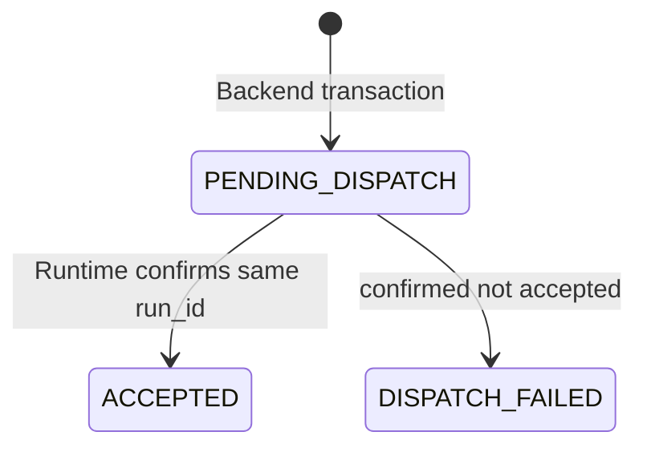
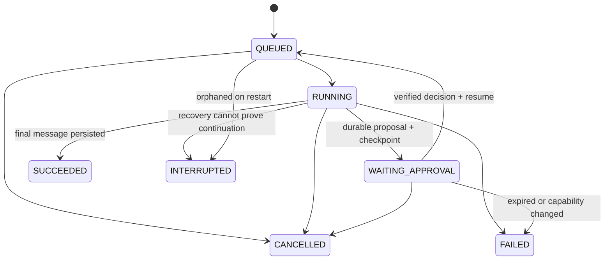

# 状态与事件

审批提案 PENDING → APPROVED / REJECTED / EXPIRED / CANCELLED。批准来源只有 Backend 的决定记录。

SSE id=seq；seq 在每个 Run 内从 1 原子递增。after_seq=0 重建，无本地草稿时不得只恢复游标。message.started 分配 message_id；delta 的 chunk_index 从 0 连续；completed 用完整正文替换，is_final=true 才投影历史。run.completed 晚于最终 completed。断线补读不重跑工具。共享 reconnect.json 含重复事件与期望去重结果。

Backend 每用户/全局订阅上限 4/32，缓冲 64，心跳 15 秒；Runtime 执行/排队 4/32。429 RESOURCE_EXHAUSTED + Retry-After，保留同一派发命令；幂等已接受请求优先于新入场限额。错误清单见 ../schemas/error-codes.json；未来业务实现不得静默换 Mock。
